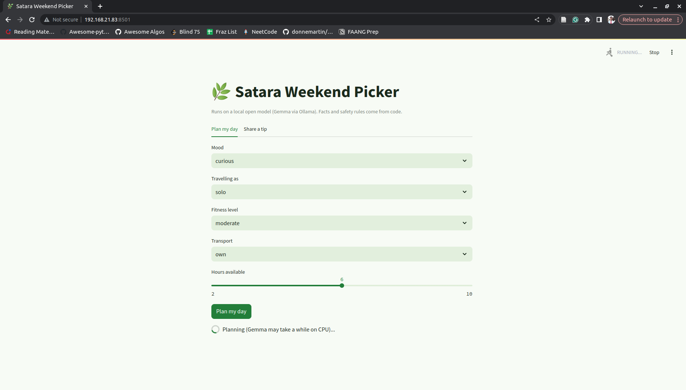
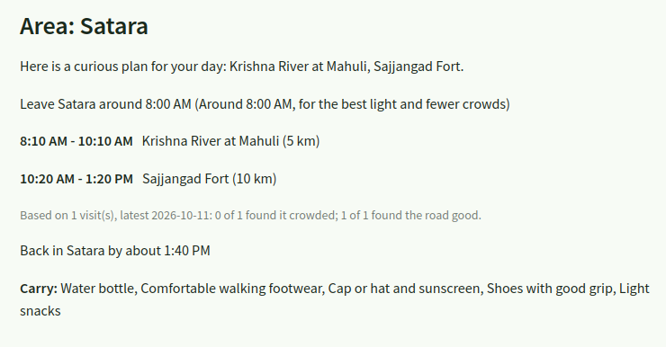
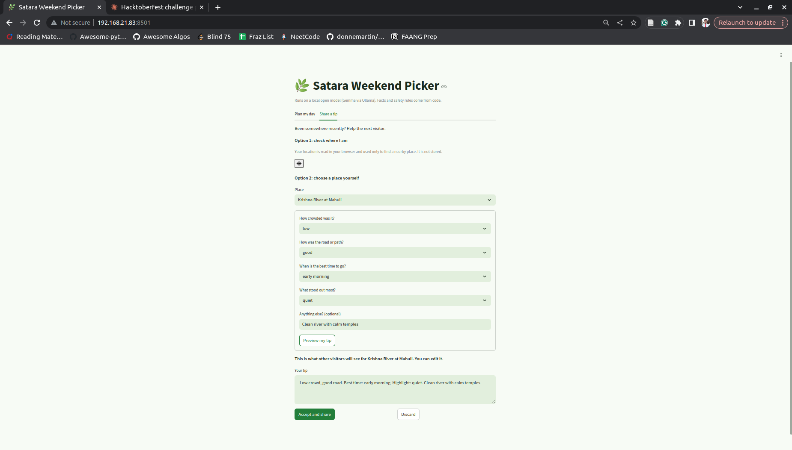
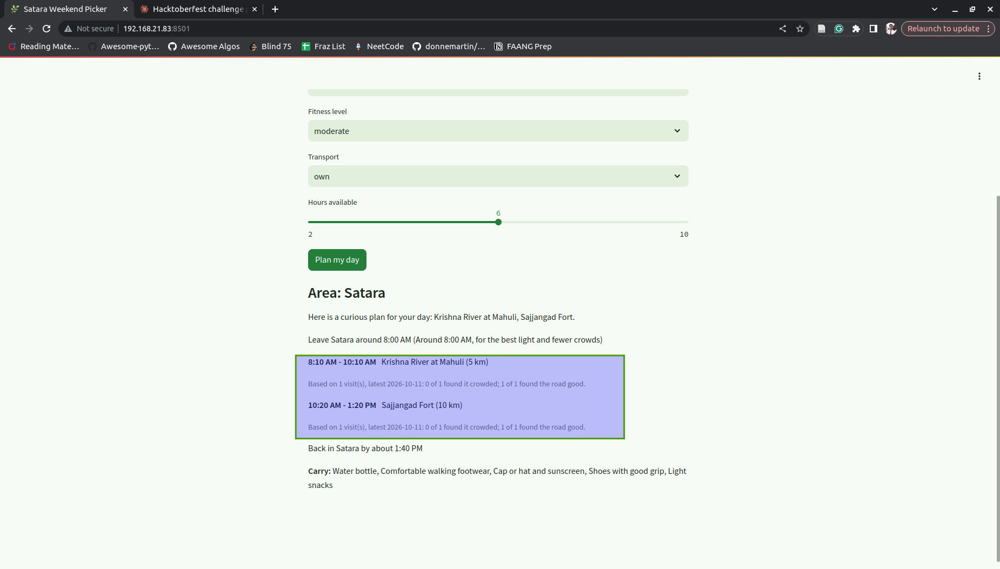

# Weekend Outdoor Picker

# 🌿 Satara Weekend Picker

**A local AI guide that plans your day in Satara, then asks you to come back and tell it what you found.**

Built for the [Hacktoberfest Open-Source AI Challenge: Week 1 (Touch Grass)](https://dev.to/challenges/hacktoberfest-week1-2026-10-05).

I'm from Satara, and I wanted my laptop to tell me where to go this weekend, without sending my mood, my location, or my habits to someone else's server. So I built a planner that runs an open-weight model (Gemma) locally, uses real weather, and learns from the people who actually visit these places.

---

## 📸 Screenshots

<!-- ADD SCREENSHOT 1 HERE: the "Plan my day" screen with a finished plan (story, timeline, carry list).
     Save the image as docs/screenshots/plan.png and keep the line below. -->




<!-- ADD SCREENSHOT 2 HERE: the "Share a tip" tab showing the questions and the tip preview.
     Save the image as docs/screenshots/tip.png and keep the line below. -->


<!-- ADD SCREENSHOT 3 HERE: a plan showing the "Based on N visit(s)..." line under a stop.
     Save the image as docs/screenshots/visitor-summary.png and keep the line below. -->


<!-- ADD SCREENSHOT 4 HERE (optional): a photo from your real visit, or the app open on your phone.
     Save the image as docs/screenshots/on-the-trail.jpg and keep the line below. -->


---

## What it does

1. **Plans a day, not just a place.** You choose your mood, who you're travelling with, your fitness level, your transport, and how many hours you have. The app builds a timed itinerary of nearby stops.
2. **Respects the real world.** It pulls today's forecast, drops spots that are unsafe or out of season, and decides the carry list and leave time with plain rules.
3. **Writes a friendly overview with Gemma.** A local model turns the finished plan into a short, warm introduction.
4. **Learns from visitors.** After a trip, you answer four quick questions (crowd, road, best time, highlight). You review the tip, then it's saved. The next plan shows what past visitors said, such as "Based on 6 visits: 4 of 6 found it crowded."
5. **Prompts you where you are.** Press "Check my location" and, if you're near a listed spot, the app offers to take your tip for that place.

---

## How it's built (and why)

The most important design decision was **what the model is not allowed to do**.

| Job | Who does it | Why |
|---|---|---|
| Season, weather, and safety filtering | Plain code | Safety rules shouldn't depend on a small model's judgement |
| Choosing stops, timings, distances | Plain code | Facts must be repeatable and checkable |
| Carry list and leave time | Plain code | My first version asked the model for these and a 1B model returned nonsense |
| Visitor tips | Structured answers, counted in code | One person's sentence is weak evidence; counts across visitors are useful |
| Friendly overview of the plan | **Gemma (local)** | Turning a plan into natural language is what a language model is good at |

Gemma only ever sees places that already passed the filters, and anything it returns is checked against the real spot list. If the model fails or goes off-script, the app falls back to a plain description instead of breaking.

### Stack
- **Model:** Gemma 3 (1B for development, 4B optional), served locally by [Ollama](https://ollama.com)
- **App:** Python 3.8+, [Streamlit](https://streamlit.io), `requests`
- **Weather:** [Open-Meteo](https://open-meteo.com) (free, no API key)
- **Data:** two open JSON files, `spots.json` and `tips.json`

---

## Why open-weight, local AI

- **Private by default.** Your mood and your location stay on your machine. The location check runs in your browser and isn't stored.
- **Runs on modest hardware.** Developed on a 7.6 GB RAM laptop with no supported GPU, using CPU only.
- **Free to run.** No per-request API fees.
- **Swappable.** Change one line (`MODEL` in `picker.py`) to try another Gemma size or a different open model.
- **Open data.** Anyone can add a place or a tip with a pull request.

---

## Run it yourself

### 1. Install Ollama and a model
Download Ollama from [ollama.com/download](https://ollama.com/download), then:

```bash
ollama pull gemma3:1b
```

### 2. Get the code
```bash
git clone <your-repo-url>
cd weekend-outdoor-picker
python3 -m venv venv
source venv/bin/activate
pip install -r requirements.txt
```

### 3. Start the app
```bash
streamlit run streamlit_app.py
```
Open the address Streamlit prints, usually `http://localhost:8501`.

### Terminal version (no browser needed)
```bash
python3 itinerary.py     # plan a day
python3 field_notes.py   # leave a tip
```

> **Heads up:** on a CPU-only machine, Gemma can take 10 to 60 seconds to answer. The app shows a spinner while it works.

---

## Using it away from your desk

- **Offline use.** The model, spots, and tips all run locally. If the weather service can't be reached, the app falls back to the last saved forecast, which may be out of date. Plan at home, then download the **trail card** (a plain text summary) to your phone so you can use it with no signal.
- **From a phone.** Phones only allow location access on secure (HTTPS) pages. For a quick test, you can expose your laptop's app through a free tunnel such as Cloudflare Tunnel. This needs internet on the phone, so it is not an offline setup.

---

## Project layout

```
├── streamlit_app.py     # web interface (planner + tip sharing + location check)
├── itinerary.py         # traveller profile, area grouping, timed schedule, Gemma overview
├── picker.py            # carry list, leave time, weather wording, Ollama call
├── spot_filter.py       # filters spots by season, weather, time and mood
├── weather.py           # Open-Meteo forecast and condition labels
├── field_notes.py       # guided questions, tip preview, visitor summaries
├── add_coords.py        # helper to add latitude/longitude/radius to spots
├── spots.json           # the places (open data)
├── tips.json            # visitor tips (open data)
└── .streamlit/config.toml   # colour theme
```

### Spot format
```json
{
  "name": "Sajjangad Fort",
  "type": "fort",
  "effort": "easy",
  "duration_hours": 3,
  "distance_km": 10,
  "area": "Satara",
  "lat": 17.0,
  "lon": 74.0,
  "radius_m": 300,
  "best_moods": ["chill", "curious"],
  "best_months": [9, 10, 11, 12, 1, 2],
  "avoid_if": ["thunderstorm"],
  "description": "Hill fort with wide valley views."
}
```
The `lat` and `lon` values above are placeholders. Use real coordinates from a map.

---

## Known limits (being honest)

- The location check needs you to press a button. Streamlit can't watch your position in the background, so a true automatic prompt would need a mobile app.
- Tips are shared through this repo's `tips.json`, not through a live server. Everyone who uses your copy sees your tips, and others can contribute by pull request.
- The dataset is small and hand-written, so distances and timings are approximate.
- A 1B model writes simple prose and can occasionally be generic. That is why it only writes the overview and never decides facts.
- Tips are unverified opinions. There is no moderation yet.

## What's next

- A hosted tips database with moderation (for example, a tip only counts after two visitors confirm it)
- Free-text mood input, where Gemma turns "tired after exams, want something quiet" into filter settings
- Marathi output for the overview
- A mobile app with real background location prompts
- More districts, added by contributors

---

## Contributing

Know a place in Satara district, or anywhere else? Add it to `spots.json` using the format above and open a pull request. Only add places you have actually visited and can describe honestly. You can also add tips by using the app and submitting your `tips.json` changes.

---

## Challenge notes

This project was started and built during the challenge window (October 5 to 11, 2026). Any commits made after the submission deadline are listed here:

- _None yet._ <!-- If you push anything after the deadline, list it here, as the rules require. -->

## License

MIT. See [LICENSE](LICENSE).